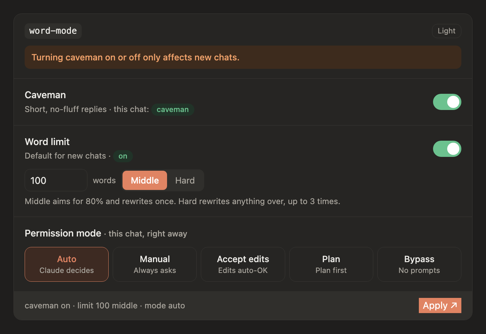

# word-mode-card

The in-chat card behind the `word-mode` Claude Code skill. One card switches three things:

1. Caveman: short, no-fluff replies (affects new chats).
2. Word limit: the default limit for new chats, from 10 to 500 words, with the `middle` or `hard` strategy.
3. Agent cap: off, or a number (default 6) of helper agents this chat may dispatch.
4. Permission mode for the current chat: Auto, Manual, Accept edits, Plan, or Bypass.



The screenshot is the dark theme. The card has a Light button.

## How it works

Pressing Apply sends one message, for example:

```text
word-mode apply caveman=on wordlimit=on limit=100 strategy=middle mode=auto agentcap=off
```

The skill reads that message and changes only what differs from the current state. If the chat cannot auto-send, the card shows the same text with a Copy button.

## Files

| File | Purpose |
| --- | --- |
| `card.full.html` | Readable source: markup, styles and script. The state is injected at `__STATE__`. |
| `card.js` | The same card as one script. It fills `#wm-root` from `window.WM_STATE`. |
| `docs/widget.png` | Screenshot used above. |

## Loading it

Each render sends only a small loader. The card code comes from jsDelivr, pinned to a tag:

```html
<div id="wm-root"></div>
<script>window.WM_STATE = {/* state */};</script>
<script src="https://cdn.jsdelivr.net/gh/GilBar2/word-mode-card@v1.1/card.js"></script>
```

`WM_STATE` fields the card reads: `caveman`, `cavemanThisChat`, `wordLimit`, `limit`, `strategy`, `mode`, and `agentcap` (`{on, cap, spent}`, or `{on:false, other:{cap, spent, date}}` for a run from another session, or `{on:false}`).

## Changing the card

1. Edit `card.full.html` and regenerate `card.js` from it.
2. Commit and push.
3. Tag a new version (`v1.2`, never reuse or move a published tag, because jsDelivr caches tags).
4. Point the loader's script URL at the new tag.
